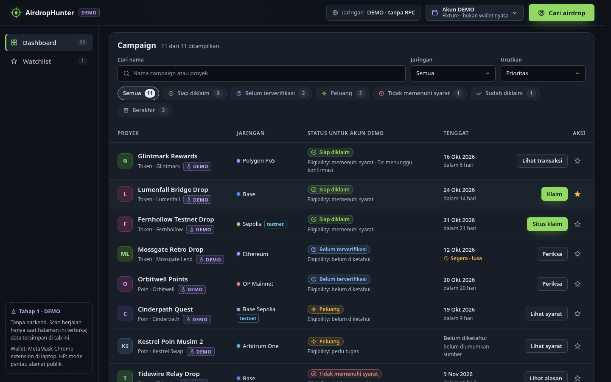
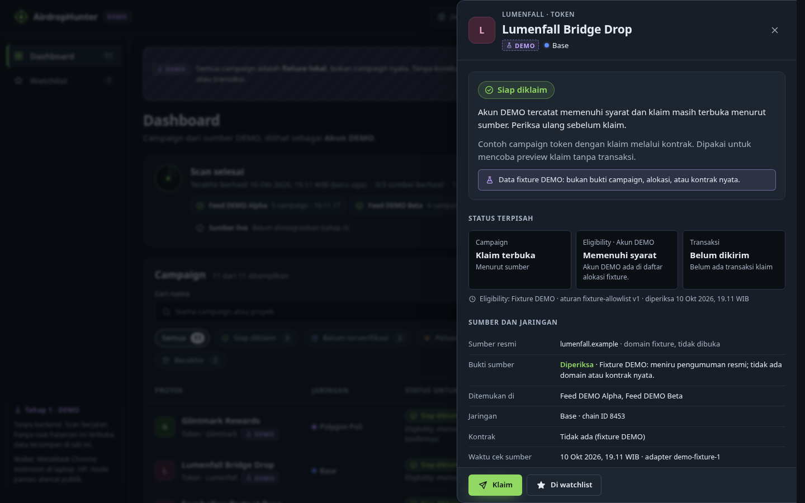
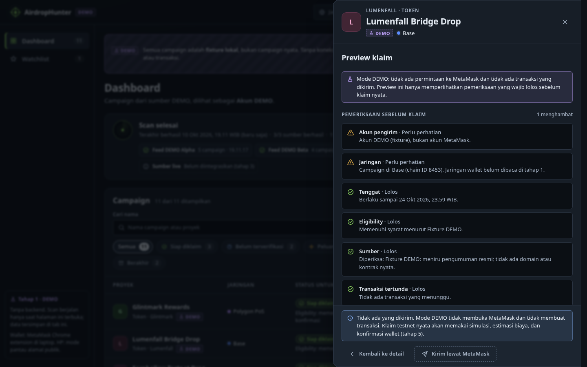
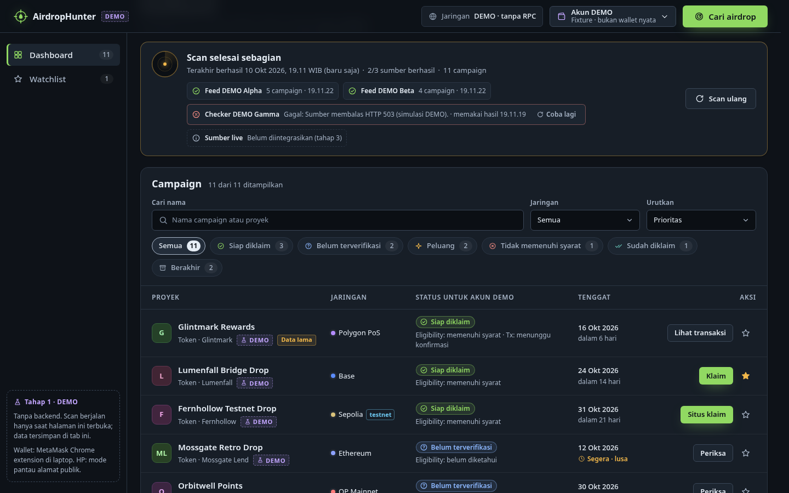
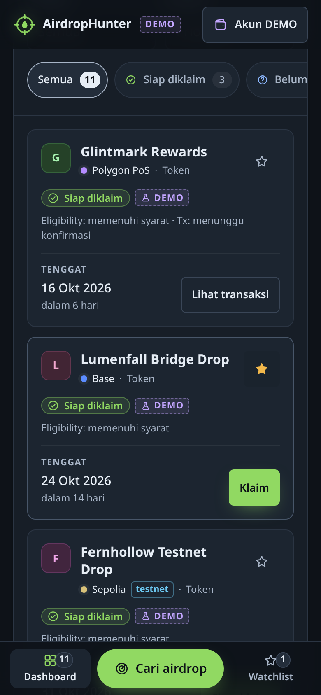
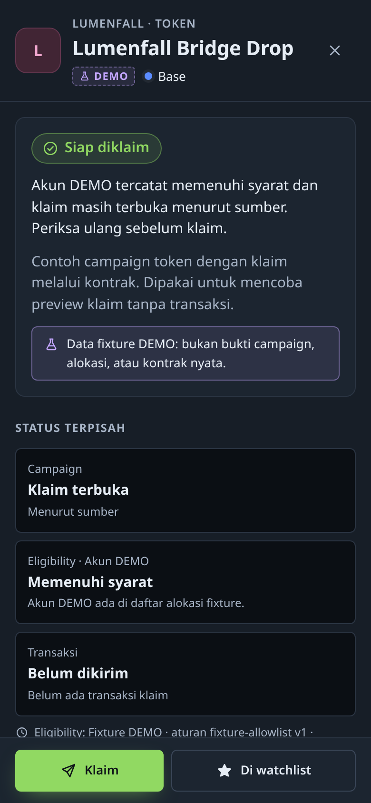
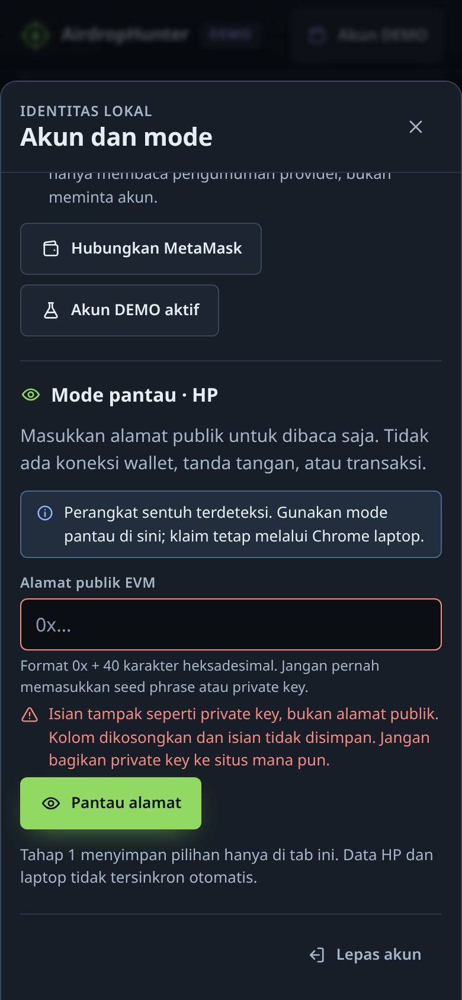
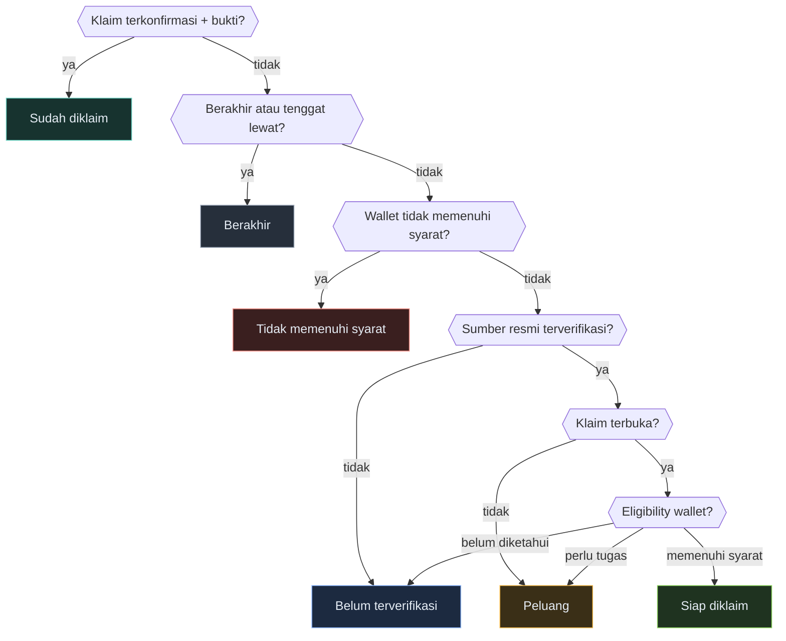
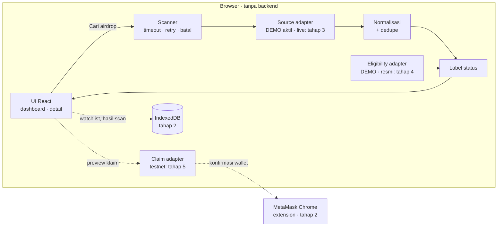

<div align="center">


<p>
  
  
  
  
  
  
  
</p>

<h3>Satu panel kerja untuk berburu airdrop dengan tenang.</h3>

<p>
Cari campaign dari sumber yang didukung, lihat statusnya untuk alamatmu, lalu siapkan klaim lewat konfirmasi wallet.<br />
Laptop memakai <b>MetaMask Chrome extension</b>, HP cukup <b>memantau alamat publik</b>, dan semuanya berjalan di browser.
</p>

<p>
  <a href="#mulai-cepat"><b>Mulai cepat</b></a> ·
  <a href="#fitur"><b>Fitur</b></a> ·
  <a href="#tampilan"><b>Tampilan</b></a> ·
  <a href="#cara-kerja"><b>Cara kerja</b></a> ·
  <a href="#roadmap"><b>Roadmap</b></a>
</p>

</div>

> [!IMPORTANT]
> **Tahap 1 adalah dashboard DEMO.** Semua campaign berasal dari fixture lokal berlabel `DEMO`, bukan campaign nyata. Belum ada koneksi wallet, RPC, data live, atau transaksi. Tombol wallet dan klaim hanya menjelaskan langkah yang akan datang.

<p align="center">
  
</p>

## Fitur

<table>
  <tr>
    <td width="33%" valign="top">
      <b>🛰️ Scan per sumber</b><br />
      Progres langsung, <b>Batalkan</b>, dan <b>Coba lagi</b> per sumber. Ada timeout, retry dengan backoff, dan hasil sebagian tetap dipakai.
    </td>
    <td width="33%" valign="top">
      <b>🔎 Cari dan saring</b><br />
      Cari nama, saring status dan jaringan, urutkan menurut prioritas, tenggat, atau nama. Jumlah per status dihitung dari data.
    </td>
    <td width="33%" valign="top">
      <b>🧭 Status yang jujur</b><br />
      Status campaign, kelayakan wallet, dan transaksi disimpan terpisah. Data gagal atau kosong menjadi <i>belum diketahui</i>, bukan “memenuhi syarat”.
    </td>
  </tr>
  <tr>
    <td valign="top">
      <b>🧾 Detail lengkap</b><br />
      Sumber resmi, bukti, chain ID, tenggat, syarat, waktu cek, dan preview klaim dengan pemeriksaan sebelum klaim.
    </td>
    <td valign="top">
      <b>📱 Mode pantau HP</b><br />
      Masukkan alamat publik untuk dibaca saja. Checksum EIP-55 divalidasi; isian yang mirip private key atau seed phrase langsung dikosongkan.
    </td>
    <td valign="top">
      <b>♿ Nyaman dipakai</b><br />
      Dialog native dengan fokus terkunci, keyboard penuh, pengumuman untuk pembaca layar, target sentuh 44 px, dan dukungan <code>prefers-reduced-motion</code>.
    </td>
  </tr>
</table>

## Tampilan

<table>
  <tr>
    <td width="50%" valign="top">
      <br />
      <sub><b>Daftar campaign</b> · filter status, jaringan, dan urutan</sub>
    </td>
    <td width="50%" valign="top">
      <br />
      <sub><b>Detail</b> · tiga status terpisah, sumber, dan tenggat</sub>
    </td>
  </tr>
  <tr>
    <td valign="top">
      <br />
      <sub><b>Preview klaim</b> · cek sebelum klaim, tanpa transaksi</sub>
    </td>
    <td valign="top">
      <br />
      <sub><b>Scan sebagian gagal</b> · Coba lagi per sumber, data lama ditandai</sub>
    </td>
  </tr>
</table>

<table>
  <tr>
    <td width="33%" valign="top">
      <br />
      <sub><b>HP</b> · kartu ringkas + bar bawah</sub>
    </td>
    <td width="33%" valign="top">
      <br />
      <sub><b>Detail layar penuh</b> · aksi tetap terlihat</sub>
    </td>
    <td width="33%" valign="top">
      <br />
      <sub><b>Mode pantau</b> · private key langsung ditolak</sub>
    </td>
  </tr>
</table>

## Mulai cepat

```bash
git clone https://github.com/Ichya20/Airdrop-Hunter.git
cd Airdrop-Hunter
npm ci
npm run dev
```

Buka `http://localhost:5173`. Butuh Node.js `^20.19.0` atau `>=22.12.0` (diuji dengan Node 22.23.3 dan npm 11.4.2).

> [!TIP]
> Memakai `AirdropHunter_Website.zip`? Ekstrak, masuk ke folder `AirdropHunter` yang memuat `package.json`, lalu jalankan `npm ci` dan `npm run dev`.

| Perintah | Fungsi |
| --- | --- |
| `npm run dev` | Server pengembangan Vite |
| `npm run typecheck` | Pemeriksaan TypeScript (`tsc -b`) |
| `npm run lint` | Oxlint |
| `npm run build` | Typecheck + build produksi ke `dist/` |
| `npm run preview` | Menyajikan hasil build |

### Coba semua keadaan

Pilih **Skenario demo** di banner atas, atau buka langsung lewat URL:

| Skenario | URL | Yang terlihat |
| --- | --- | --- |
| Normal | `/` | 3 sumber berhasil, 11 campaign |
| Sebagian gagal | `/?skenario=partial` | 1 sumber membalas HTTP 503, hasil lain tetap tampil, **Coba lagi** memulihkan |
| Semua gagal | `/?skenario=all_fail` | Pesan error per sumber dan tombol pemulihan |
| Kosong | `/?skenario=empty` | Keadaan kosong dengan langkah lanjut |
| Lambat | `/?skenario=slow` | Progres 3–6 detik untuk mencoba **Batalkan** |

### Pantau dari HP

1. Di laptop, jalankan `npm run dev -- --host` lalu catat alamat **Network**, misalnya `http://192.168.1.10:5173`.
2. Di HP yang tersambung ke Wi-Fi yang sama, buka alamat itu. `localhost` di HP menunjuk ke HP sendiri, bukan ke laptop.
3. Buka **Akun → Mode pantau** dan masukkan alamat publik `0x…`. Koneksi wallet, tanda tangan, dan klaim tetap lewat MetaMask Chrome extension di laptop.

> [!NOTE]
> Alamat HTTP di jaringan lokal bukan *secure context*: tombol Salin memakai cara cadangan dan PWA belum tersedia. Data tahap 1 hanya ada di tab yang sedang terbuka; laptop dan HP tidak tersinkron.

## Cara kerja

### Enam label dari status yang terpisah

Campaign dengan klaim terbuka belum tentu bisa diklaim oleh wallet-mu. Label dihitung dari kombinasi status dan berhenti di aturan pertama yang cocok:



| Label | Aksi utama |
| --- | --- |
| Siap diklaim | **Klaim** lewat kontrak, atau **Situs klaim** resmi |
| Peluang | Lihat syarat, tanpa janji hadiah |
| Belum terverifikasi | Periksa sumber atau checker resmi |
| Tidak memenuhi syarat | Lihat alasan dari sumber |
| Sudah diklaim | Lihat transaksi dan bukti |
| Berakhir | Arsip, klaim dinonaktifkan |

### Arsitektur

UI tidak pernah memanggil endpoint secara langsung. Setiap sumber adalah adapter yang mengembalikan hasil terstruktur (sumber, waktu cek, status, error), sehingga sumber live, eligibility resmi, dan klaim testnet bisa dipasang bertahap.



## Keamanan lebih dulu

- 🔐 Tidak pernah meminta, menyimpan, atau mengirim seed phrase maupun private key. Isian yang mirip rahasia langsung dikosongkan.
- 🧪 Fixture DEMO tidak punya jalur klaim, alamat kontrak, atau hash transaksi. Domainnya memakai `.example` dan tidak dibuka.
- ❔ Error, timeout, atau mekanisme yang belum didukung selalu menjadi **belum diketahui**, tidak pernah “memenuhi syarat”.
- ✅ Klaim baru dianggap berhasil dengan receipt sukses dan bukti dari adapter. Hash saja berarti masih menunggu.
- 🛑 Klaim standar tidak boleh diam-diam meminta unlimited approval, Permit, atau transfer aset lain.
- 🚫 Tanpa backend, database cloud, atau rahasia di bundle. File `.env` diabaikan Git.

## Roadmap

- [x] **Tahap 1** · Dashboard DEMO: scan, filter, detail, watchlist, mode pantau, preview klaim
- [ ] **Tahap 2** · Koneksi MetaMask lewat wagmi + viem, penyimpanan IndexedDB per alamat dan jaringan
- [ ] **Tahap 3** · Satu sumber live tervalidasi dengan pembaruan berbasis TTL
- [ ] **Tahap 4** · Eligibility dari aturan, proof, atau snapshot resmi
- [ ] **Tahap 5** · Klaim testnet: simulasi, estimasi biaya, konfirmasi wallet, dan receipt

Rinciannya ada di [`tasks.md`](.kiro/specs/airdrop-hunter-mvp/tasks.md), dengan kebutuhan di [`requirements.md`](.kiro/specs/airdrop-hunter-mvp/requirements.md) dan rancangan di [`design.md`](.kiro/specs/airdrop-hunter-mvp/design.md).

## Hasil pemeriksaan tahap 1

| Pemeriksaan | Hasil |
| --- | --- |
| `npm ci`, `typecheck`, `lint`, `build` | ✅ exit 0 |
| Tes interaksi Playwright: desktop, HP 390/320 px, tablet, build produksi | ✅ 48/48 lulus (skrip di luar repo) |
| Lebar laptop 1024–1440 px | ✅ tanpa scroll horizontal |
| Kontras 27 pasangan warna | ✅ terendah 5,48:1 |
| MetaMask terpasang, HP fisik, pembaca layar | ⏳ belum diuji |

Catatan lengkap ada di [`docs/cek-hasil.md`](docs/cek-hasil.md).

## Struktur proyek

```text
src/
├── app/              App shell, header, navigasi, routing hash
├── components/       Ikon, badge, dialog native, tampilan alamat
├── features/
│   ├── dashboard/    Daftar, filter, detail, watchlist
│   ├── scanner/      Orkestrasi scan dan panel status
│   ├── wallet/       Identitas lokal dan mode pantau
│   └── claims/       Preview klaim dan riwayat transaksi
├── adapters/         sources · eligibility · claims
├── domain/           Tipe, normalisasi, label status, validasi
├── demo/             Fixture berlabel DEMO
└── styles/           Token warna, layout, komponen
.kiro/                Spec (requirements, design, tasks) dan steering
docs/                 Hasil pemeriksaan dan aset README
```

---

<div align="center">
<sub>AirdropHunter tidak menjanjikan semua airdrop ditemukan, hadiah diterima, atau token bernilai.<br />Selalu periksa sumber resmi sebelum menghubungkan wallet.</sub>
</div>
