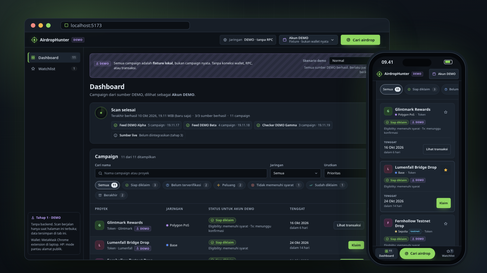

<div align="center">



<p>
  
  
  
  
  
  
  
</p>

<h3>Satu panel kerja untuk berburu airdrop dengan tenang.</h3>

<p>
Cari kandidat protokol dari sumber yang didukung, pantau alamat publik, dan lihat preview klaim DEMO.<br />
Laptop memakai <b>MetaMask Chrome extension</b>, HP cukup <b>memantau alamat publik</b>, dan semuanya berjalan di browser dengan penyimpanan lokal <b>IndexedDB</b>.
</p>

<p>
  <a href="#mulai-cepat"><b>Mulai cepat</b></a> ·
  <a href="#fitur"><b>Fitur</b></a> ·
  <a href="#roadmap"><b>Roadmap</b></a>
</p>

</div>

> [!IMPORTANT]
> **Patch free bernilai sebelum Tahap 5:** Token dibagikan gratis, tersedia untuk diklaim ke wallet, dan memiliki harga serta likuiditas pasar positif. **Gas jaringan boleh diperlukan.** Collector tidak memilih koin tertentu atau membatasi total hasil, dalam cakupan sumber dan jaringan yang didukung. Reward wallet diperiksa melalui API Merkl, lalu harga USD dan likuiditasnya diperiksa melalui DEX Screener. Kandidat dengan bukti pasar tetap bukan jaminan penjualan atau bukti token sudah masuk wallet. Transaksi klaim Tahap 5 belum diaktifkan. Lihat [kriteria free bernilai](docs/free-bernilai.md) dan [cakupan pencarian](docs/pencarian-luas.md).

<p align="center">
  
</p>

Gambar showcase berasal dari versi awal. Screenshot pengujian perapihan 0.3.1 dengan data tiruan tersedia di [`docs/cek-hasil.md`](docs/cek-hasil.md).

## Fitur

<table>
  <tr>
    <td width="33%" valign="top">
      <b>🌐 Sumber Live & Rate Limit (Tahap 3)</b><br />
      Mengambil metadata API DefiLlama langsung dari browser tanpa proxy cloud, dengan pembatasan per sumber, <code>Retry-After</code> HTTP 429, retry yang bisa dibatalkan, dan referensi <b>ARSIP LOKAL</b>.
    </td>
    <td width="33%" valign="top">
      <b>🦊 Koneksi MetaMask (Tahap 2)</b><br />
      Terhubung lewat EIP-6963/EIP-1193 tanpa meminta tanda tangan. Menangani penolakan koneksi, ganti jaringan, dan pergantian akun secara reaktif.
    </td>
    <td width="33%" valign="top">
      <b>🗄️ IndexedDB & Cadangan (Tahap 2)</b><br />
      Pengaturan, watchlist, dan hasil scan tersimpan lokal. Cache segar per sumber, termasuk hasil kosong, mencegah fetch otomatis berulang; ekspor/impor JSON memvalidasi skema dan menerima hash transaksi publik.
    </td>
  </tr>
  <tr>
    <td valign="top">
      <b>🧭 Status yang jujur</b><br />
      Status campaign, kelayakan wallet, dan transaksi disimpan terpisah. Indikasi agregator tanpa bukti klaim resmi diberi label <i>Belum terverifikasi</i>, bukan “Siap diklaim”.
    </td>
    <td valign="top">
      <b>📱 Mode pantau HP</b><br />
      Masukkan alamat publik untuk dibaca saja. Checksum EIP-55 divalidasi; isian yang mirip private key atau seed phrase langsung dikosongkan.
    </td>
    <td valign="top">
      <b>♿ Nyaman dipakai</b><br />
      Dialog native dengan fokus terkunci, keyboard penuh, pengumuman untuk pembaca layar, target sentuh 44 px, dan dukungan <code>prefers-reduced-motion</code>.
    </td>
  </tr>
</table>

## Mulai cepat

```bash
npm ci
npm run dev
```

Buka `http://localhost:5173`. Butuh Node.js `^20.19.0` atau `>=22.12.0`.

| Perintah | Fungsi |
| --- | --- |
| `npm run dev` | Server pengembangan Vite |
| `npm run typecheck` | Pemeriksaan TypeScript (`tsc -b`) |
| `npm test` | Tes Tahap 2–4 dan regresi perapihan |
| `npm run test:stage4` | Tes terarah patch eligibility dan regresi penyimpanan; tanpa build aplikasi |
| `npm run test:discovery` | Tes terarah perluasan sumber, reward wallet, paginasi, dan pemeriksaan biaya |
| `npm run test:value` | Tes terarah kriteria free bernilai, bukti pasar, dan regresi terkait; tanpa build aplikasi |
| `npm run lint` | Oxlint |
| `npm run build` | Typecheck + build produksi ke `dist/` |
| `npm run preview` | Menyajikan hasil build |

## Roadmap

- [x] **Tahap 1** · Dashboard DEMO: scan, filter, detail, watchlist, mode pantau, preview klaim
- [x] **Tahap 2** · Koneksi MetaMask (EIP-6963/EIP-1193), deteksi jaringan salah, penyimpanan IndexedDB per alamat + chain ID + campaign + versi adapter, migrasi & ekspor/impor cadangan
- [x] **Tahap 3** · Metadata protokol live DefiLlama, kandidat belum terverifikasi, arsip referensi lokal, cache per sumber, dan retry dengan rate limit
- [x] **Perapihan 0.3.1** · Hidrasi cache sebelum scan otomatis, invalidasi checkpoint versi adapter lama, validasi backup, dan pemisahan label LIVE/ARSIP LOKAL
- [x] **Tahap 4** · Adapter proof UNI + pembacaan kontrak resmi, hasil usang, dan pemeriksaan ulang per alamat
- [x] **Tambahan sebelum Tahap 5** · Pencarian tanpa pilihan koin/top-N, katalog Merkl dan reward per alamat, serta pemeriksaan token gratis dengan harga dan likuiditas positif; gas diperiksa terpisah
- [ ] **Tahap 5** · Klaim testnet: simulasi, estimasi biaya, konfirmasi wallet, dan receipt

Arsip lokal memakai `status: ended` agar aksi klaim tetap nonaktif di aplikasi. Untuk UNI, `deadline: null`: tanggal peluncuran historis tidak digunakan sebagai tenggat klaim. Status eligibility dan waktu pembacaan kontrak ditampilkan terpisah dari timestamp pemuatan arsip. Hasil `isClaimed` tidak membuat transaksi terkonfirmasi atau label Sudah diklaim tanpa bukti transaksi.

Rinciannya ada di [`tasks.md`](.kiro/specs/airdrop-hunter-mvp/tasks.md), dengan perilaku sumber data di [`docs/sumber-data.md`](docs/sumber-data.md), kebutuhan di [`requirements.md`](.kiro/specs/airdrop-hunter-mvp/requirements.md), rancangan di [`design.md`](.kiro/specs/airdrop-hunter-mvp/design.md), dan hasil serta batas verifikasi di [`docs/cek-hasil.md`](docs/cek-hasil.md).
