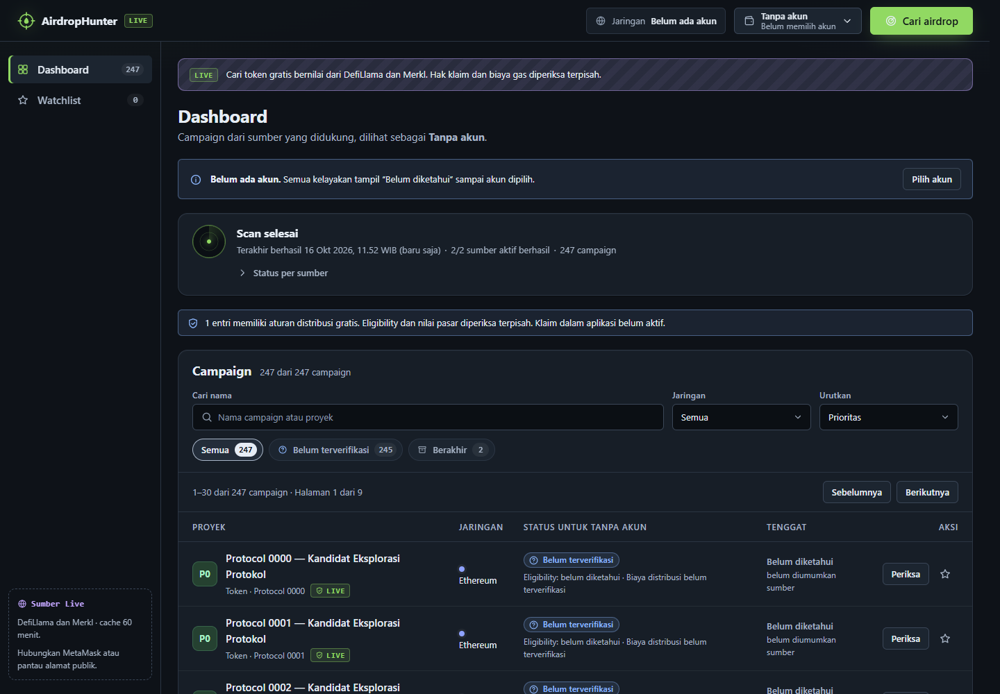
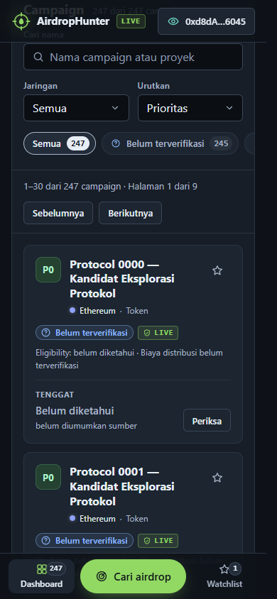

# Optimasi AirdropHunter sebelum Tahap 5

Tanggal verifikasi: 16 Oktober 2026, WIB. Acuan utama: `D:/AirdropHunter-main.rar`.

SHA-256 RAR: `c8a3509aa72ae48ef84d377577304a94fd3f429089fccc733c14d26f0dbabdb9`.

## Hasil terukur

| Ukuran JavaScript awal | RAR asli | Hasil optimasi | Pengurangan |
| --- | ---: | ---: | ---: |
| Tanpa kompresi | 1.419,03 kB | 420,52 kB | 70,4% |
| Gzip dengan pengaturan yang sama | 377,00 kB | 124,76 kB | 66,9% |

Angka hasil optimasi mencakup seluruh berkas JS yang benar-benar diminta browser sebelum interaksi: `index-DcJA054K.js`, `utils-Bpv4vmSW.js`, `isAddress-DHgfdY-D.js`. Baseline memakai bundle utama yang disertakan dalam RAR. Kompresi kedua sisi dihitung dengan `node:zlib.gzipSync` pada runtime yang sama; angka Vite dapat sedikit berbeda. Ini ukuran unduhan, bukan klaim pengurangan waktu muat atau pemakaian RAM dengan persentase yang sama.

## Perubahan

- Mengganti impor konfigurasi jaringan lengkap dengan metadata ringkas 742 alias jaringan. Cakupan ID/nama/testnet tetap diperiksa terhadap viem yang terpasang; regenerasi tersedia di `scripts/generate-chain-metadata.mjs`.
- Memuat detail campaign, dialog akun, pemeriksaan kontrak UNI, dan validator impor cadangan sesuai kebutuhan. Pemeriksaan alamat serta perlindungan rahasia wallet tetap berlaku.
- Menampilkan maksimum 30 campaign per halaman. Seluruh hasil discovery tetap disimpan dan dapat ditelusuri; tidak ada pembatasan top-N.
- Menunda pemrosesan pencarian, memakai ulang teks normalisasi/collator, dan mem-parsing tenggat sekali per campaign saat mengurutkan.
- Menggabungkan pembaruan harga, melewati jeda jaringan untuk hasil yang dapat ditentukan lokal, serta mencegah pemeriksaan detail otomatis yang berulang untuk token/scope yang sama. Refresh manual tetap mengambil data baru; TTL dan isolasi wallet tetap diuji.
- Panel reward tidak membuat DOM baris saat tertutup. Pagination reward tetap tersedia untuk seluruh entri.
- Membaca record IndexedDB secara batch. Mempertahankan daftar campaign saat hanya progres scan berubah; mengurangi pembacaan statistik penyimpanan yang tidak diperlukan. Timer pembaruan waktu berhenti saat tab tersembunyi.
- Sumber live dan tanpa akun menjadi default. Pilihan sumber/skenario DEMO serta akun DEMO tersembunyi dari alur normal, tetapi tetap tersedia lewat URL pengujian `?skenario=normal`.
- Menyembunyikan filter status tanpa hasil, merangkum rincian sumber serta cadangan, menghapus pilihan jaringan cepat yang menduplikasi dropdown, dan mengganti tombol kirim yang belum berfungsi dengan keterangan Tahap 5.
- Memperpendek penjelasan yang berulang dan mengarahkan tombol simpan watchlist tanpa akun ke pemilih akun.

## Verifikasi

- `npm test`: **164 skenario lulus**. Mencakup wallet/eligibility, penyimpanan, sumber, retry, nilai pasar, dan regresi performa.
- `npm run lint`: lulus tanpa peringatan.
- `npm run build`: TypeScript dan build produksi lulus; tidak ada peringatan chunk di atas 500 kB.
- Regresi daftar menelusuri seluruh 2.501 campaign tanpa duplikasi/pemotongan; 1.000 tenggat diparsing tepat 1.000 kali saat sort.
- Fixture burst 325 quote diproses lengkap dengan maksimal 4 publikasi snapshot UI. Angka ini mengukur respons tiruan cepat, bukan jumlah pembaruan yang dijanjikan pada jaringan nyata.
- Uji Chrome headless pada dev StrictMode dan build produksi memakai API/wallet publik tiruan. Desktop 1440 × 1000 dan HP 390 × 844 diperiksa.

- Desktop: 247 campaign tersedia, hanya 30 baris dirender; kontrol demo tersembunyi.
- Pagination: halaman terakhir dapat dibuka (7 hasil), tidak ada pemotongan total.
- Pencarian, lazy detail, Escape, dan pemulihan fokus berfungsi.
- Reward: 123 entri, DOM kosong saat tertutup, halaman 100 + 23 berfungsi.
- Watchlist dan identitas bertahan sesudah refresh; cache sumber mencegah fetch katalog ulang.
- HP 390 px: 30 kartu, akun dan navigasi berjalan, tidak ada overflow dokumen.
- Lazy panel lambat: aksi terakhir membuka satu dialog; simpan tanpa akun membuka pemilih akun.
- Skenario DEMO eksplisit: hasil sebagian dan coba lagi pulih tanpa API eksternal.
- Pembatalan scan lambat menghentikan proses dan menampilkan keadaan yang dapat dipulihkan.

Tidak ada galat JavaScript atau overflow dokumen dalam skenario yang diuji. Cache sumber membuat reload pada origin yang sama tidak mengulang permintaan katalog yang masih segar. Harga, wallet, dan hasil scan lama tetap dipisahkan menurut scope yang sesuai.

## Batas verifikasi

API live/CORS pada hosting tujuan, ekstensi MetaMask fisik, perangkat HP fisik, dan pembaca layar nyata belum diuji pada pekerjaan ini. Pengujian antarmuka memakai data simulasi, termasuk 245 protokol ditambah dua arsip lokal dan 123 entri reward. Keandalan API eksternal tetap bergantung pada layanan dan jaringan pengguna. Klaim, simulasi transaksi, tanda tangan, dan receipt Tahap 5 belum diaktifkan.

## Menjalankan

Ekstrak paket lengkap ke folder baru. Jalankan `npm ci` lalu `npm run dev`; build siap hosting ada di `dist/`. Panduan rinci: [MULAI-DI-SINI.md](../MULAI-DI-SINI.md).

## Tampilan setelah optimasi

Gambar berikut memakai fixture pengujian, bukan temuan airdrop nyata.

